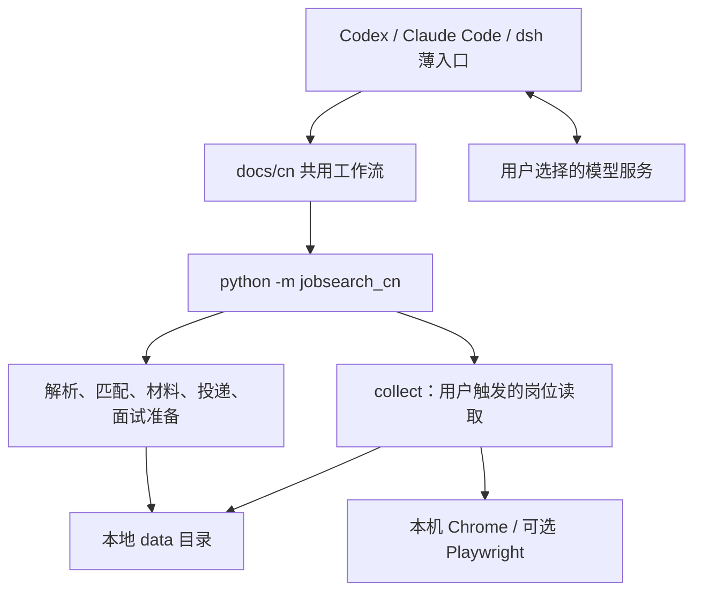

# CN 当前实现与代码索引

本文按已合并的 CN 能力说明代码怎么组织，供定位实现和判断改动范围使用。字段、命令和确认步骤仍以各能力的共用文档为准；架构决策的理由见 [ADR](cn-migration-plan.md#2-架构决策)，最终目标和未完成事项见[总体规划](master-plan.md)与[路线图](roadmap.md)。

## 1. 入口与执行

- Codex 从 [AGENTS.md](../../AGENTS.md) 找到 CN 流程；Claude Code 的入口在 [.claude/skills/](../../.claude/skills/)，dsh 的入口在 [.dsh/skills/](../../.dsh/skills/)。它们引用同一份流程。dsh 已有五个工作流入口，面试准备入口目前只接入 Codex 和 Claude Code；各端入口由 [test_cn_agent_entry.py](../../tests/test_cn_agent_entry.py) 核对，运行时实际验收另在路线图跟踪。
- [__main__.py](../../jobsearch_cn/__main__.py) 调用 [cli.py](../../jobsearch_cn/cli.py) 的 `main`。CLI 负责参数、UTF-8 输出和命令分派，具体规则放在各能力模块。
- 执行结果通常是 JSON；`--help`、`--version` 是文本。调用方同时检查退出码、stdout 和 stderr，错误字段与退出码按对应命令的契约处理，不能只凭 stdout 非空判断成功。
- 起草、语义补全和独立内容审核由 Agent 完成。CN Python 工具处理本地输入，不调用模型 API、不管理模型密钥。Agent 读到的内容如何发送给模型服务，取决于用户选用的运行时和配置。

## 2. 从能力定位代码

| 命令组 | 主要实现 | 契约与共用流程 |
| --- | --- | --- |
| `jd` | [jd_parser.py](../../jobsearch_cn/jd_parser.py) 规则解析；[schema.py](../../jobsearch_cn/schema.py) 记录校验；[guard.py](../../jobsearch_cn/guard.py) 注入提示；[store.py](../../jobsearch_cn/store.py) 去重与保存；[screen.py](../../jobsearch_cn/screen.py) 和 [inbox.py](../../jobsearch_cn/inbox.py) 处理批次 | [岗位格式](job-schema.md)、[JD 导入](jd-import.md)、[批量初筛](screen.md) |
| `profile` | [profile.py](../../jobsearch_cn/profile.py) 档案校验；[resume_extract.py](../../jobsearch_cn/resume_extract.py) 从 DOCX/PDF 提取文本 | [档案格式](profile.md)、[建档流程](profile-setup.md) |
| `match` | [match.py](../../jobsearch_cn/match.py) 硬性条件；[score.py](../../jobsearch_cn/score.py) 评分；[vocab.py](../../jobsearch_cn/vocab.py) 词表；[report.py](../../jobsearch_cn/report.py) 报告 | [匹配](match.md) |
| `material` | [material.py](../../jobsearch_cn/material.py) 材料与引用校验；[content.py](../../jobsearch_cn/content.py) 内容映射；[messages.py](../../jobsearch_cn/messages.py) 和 [followups.py](../../jobsearch_cn/followups.py) 沟通草稿 | [材料格式](material.md)、[简历与沟通流程](resume-workflow.md) |
| `resume` | [resume_pdf.py](../../jobsearch_cn/resume_pdf.py) Typst 编译与 PDF 检查；[resume_docx.py](../../jobsearch_cn/resume_docx.py) Word 生成与检查；[build_notes.py](../../jobsearch_cn/build_notes.py) 生成物绑定 | [简历生成](resume-pdf.md) |
| `review` | [review.py](../../jobsearch_cn/review.py) 机器初稿、审核结果校验和材料绑定 | [审核格式](review-format.md)、[审核清单](review-checklist.md) |
| `application` | [applications.py](../../jobsearch_cn/applications.py) SQLite、事件和归档；[application_report.py](../../jobsearch_cn/application_report.py) 看板；[calibration.py](../../jobsearch_cn/calibration.py) 只读复盘 | [投递记录](applications.md)、[复盘](calibration.md) |
| `interview` | [interview.py](../../jobsearch_cn/interview.py) 准备包；[interview_files.py](../../jobsearch_cn/interview_files.py) 文件与引用边界；[interview_review.py](../../jobsearch_cn/interview_review.py) 审核绑定 | [面试准备](interview.md) |
| `collect` | [collect.py](../../jobsearch_cn/collect.py) 采集流程；[browser.py](../../jobsearch_cn/browser.py) 浏览器；[beisen.py](../../jobsearch_cn/beisen.py) 北森；[robots_policy.py](../../jobsearch_cn/robots_policy.py) 来源检查；[personal.py](../../jobsearch_cn/personal.py) 默认关闭的本机模块入口 | [采集与来源边界](collect.md) |

CN 的确定性逻辑集中在 `jobsearch_cn/`。`.agents/skills/` 保留上游招聘门户契约；本地导入、建档和材料流程使用 CN 薄入口，具体边界见 [AGENTS.md](../../AGENTS.md)。

## 3. 数据与产物

[store.data_dir](../../jobsearch_cn/store.py) 的选择顺序为：显式 `--data-dir`、`JOBSEARCH_CN_DATA_DIR`、该工作树根目录下的 `data/`。测试或复现使用独立数据根，避免与日常求职资料混用。

| 相对数据根的路径 | 保存什么 | 实现或格式 |
| --- | --- | --- |
| `jobs/job_*.json`、`matches/job_*.json` | 当前岗位记录与每个岗位的匹配记录 | [store.py](../../jobsearch_cn/store.py)、[匹配记录](match.md) |
| `profile/profile.json`、`profile/notes.md`、`profile/sources/` | 结构化档案、叙述性经历与用户提供的来源文件 | [档案格式](profile.md) |
| `materials/<岗位id>/` | 简历或沟通材料 JSON、对应审核结果 | [材料格式](material.md)、[审核格式](review-format.md) |
| `resumes/<岗位id>/`、`messages/<岗位id>/` | 生成的 PDF、DOCX、沟通正文及生成记录 | [简历流程](resume-workflow.md) |
| `applications/applications.sqlite3` | 投递元数据、事件、当前状态与版本信息 | [投递记录](applications.md) |
| `applications/artifacts/`、`applications/backups/`、`applications/exports/` | 投递时归档的材料、备份和导出 | [投递记录](applications.md) |
| `interviews/<岗位id>/` | 面试准备包、Markdown 和审核结果 | [面试准备](interview.md) |
| `reports/`、`inbox/` | 本地报告、离线看板快照及待导入收件批次 | [匹配报告](match.md)、[离线看板](applications.md#19-离线投递看板m4-4)、[收件格式](screen.md) |

JSON 文件保留可查看的岗位与材料内容；SQLite 负责投递事件和并发写入，材料文件另行归档。首次记录时的归档评分不一定是实际投出前评分，复盘按 [calibration.md](calibration.md) 保留这种区别。

## 4. 校验各自保证什么

1. **岗位输入**：`jd parse` 做规则抽取和注入提示，`jd validate` 核对结构与原文证据。未知字段保留 `null`；注入提示本身不会替 Agent 作出安全判断，JD 始终作为外部数据处理。
2. **材料与生成物**：材料校验核对档案引用，生成层检查 PDF/DOCX 和内容绑定。`review draft` 只提供机器初稿；独立内容审核及重新生成、重新绑定的顺序仍按[共用流程](resume-workflow.md)。
3. **投递写入**：先 `--preview`，经用户确认后使用对应 `--request-id` 写入；请求去重、版本冲突和归档由 [applications.py](../../jobsearch_cn/applications.py) 处理。命令记录投递事实，实际发送另由用户完成。
4. **复盘与看板**：读取记录并生成汇总。复盘不自行调整权重，看板不写投递事件；用户决定后的调整交回原工作流。

这些检查覆盖各自的结构、引用和行为合同。PDF 自动检查、DOCX 结构检查和虚构样例通过，分别不能代替 Word/WPS 页面验收、独立内容审核或真实求职验收。

## 5. 依赖和扩展位置

- 解析、规则、存储默认只用标准库、离线；`browser.py` 的函数内可选导入 Playwright 是 [ADR-4](cn-migration-plan.md#2-架构决策) 已有的限定例外，由 [test_cn_package.py](../../tests/test_cn_package.py) 守护。普通 CLI 导入不要求安装 Playwright。
- PDF 文本提取通过子进程调用上游 PDF 工具，Typst 是简历编译外部工具；安装和字体按[快速开始](../../README.md#快速开始)与[简历生成](resume-pdf.md)处理。DOCX 的生成和读取使用标准库。
- 技能词表在 [skills.json](../../jobsearch_cn/skills.json)，沟通模板在 [message_templates/](../../jobsearch_cn/message_templates/)，面试题目在 [interview_questions/](../../jobsearch_cn/interview_questions/)；扩展方向先读对应格式约定。
- 来源接入先核对[采集文档](collect.md)和 ADR-9。公开框架的本机模块入口只加载用户显式配置的本地代码，不能据此推断任意站点已有适配或已获准采集。
- 修改能力时同步对应共用文档、薄入口和必要的测试。开发环境、提交流程和权限变更要求统一见[贡献指南](contributing.md)。
